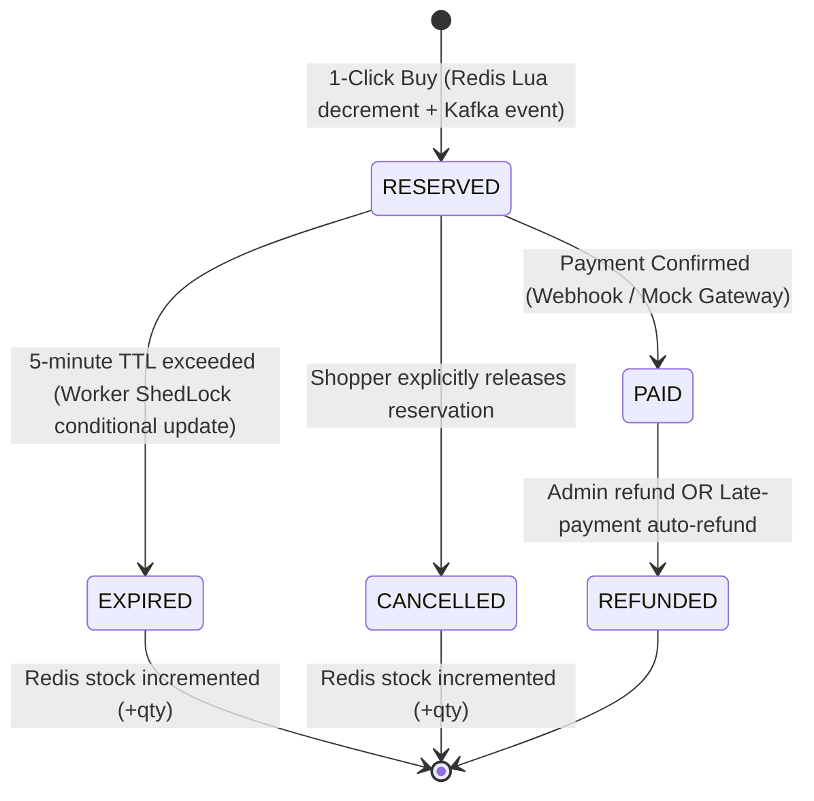

# FlashDrop: Production-Standard Flash Sale Platform

A high-concurrency, resilient flash-sale platform designed for a **single merchant** to host high-velocity drops with zero overselling, guaranteed inventory integrity, and safe failure handling.

---

## Architecture Overview

```
                                      ┌──────────────────────────────────────────────┐
                                      │              Frontend (Port 3000)            │
                                      │     Storefront, Checkout & Admin Portal      │
                                      └──────────────┬────────────────┬──────────────┘
                                                     │                │
                         Reservations (Hot Path)     │                │   Catalog, Auth, Payments, Admin
                         POST /orders/reserve        │                │   /api/v1/**
                                                     ▼                ▼
                                      ┌──────────────────┐     ┌──────────────────────┐
                                      │   Order Service  │     │     Core Service     │
                                      │    (Port 8080)   │     │      (Port 8082)     │
                                      └────────┬─────────┘     └──────────┬───────────┘
                                               │                          │
                 ┌─────────────────────────────┼──────────────────────────┼─────────────────────┐
                 │                             │                          │                     │
                 ▼                             ▼                          ▼                     ▼
          ┌─────────────┐               ┌─────────────┐            ┌─────────────┐       ┌─────────────┐
          │    Redis    │◄──────────────┤    Kafka    │───────────►│ Worker Serv │       │  PostgreSQL │
          │ (Inventory) │               │   Broker    │            │ (Port 8081) │◄─────►│  (Flyway)   │
          └─────────────┘               └─────────────┘            └─────────────┘       └─────────────┘
```

The system is deliberately scoped to three dedicated backend services:

1. **`order-service` (Port 8080 - The Hot Path)**:
   - Redis and Kafka only — **zero database connections**.
   - Sub-10ms response times.
   - Stateless JWT authentication: extracts `userId` from claims directly without touching PostgreSQL.
   - Atomic Lua script executing:
     - Sale `LIVE` status validation
     - Per-user purchase limit enforcement (`flashsale:user_orders:{saleId}:{userId}`)
     - Atomic inventory decrement (`flashsale:stock:{saleId}`)
   - Idempotency guard (`SET NX` with 5-minute TTL).
   - Asynchronous Kafka event publisher with retry and Redis fallback queue.

2. **`core-service` (Port 8082 - Single Source of Truth)**:
   - Backed by PostgreSQL with Flyway database migrations.
   - User authentication and role-based access (`ROLE_SHOPPER`, `ROLE_ADMIN`) issuing signed JWT access and refresh tokens.
   - Catalog management (products CRUD) and flash sale scheduling.
   - Automated Sale Preloader: scheduled background worker preloads inventory into Redis shortly before drop time, replacing manual initialization.
   - Mock payment gateway and Razorpay test mode integration.
   - Shopper orders history ("My Orders") and Admin operations hub.
   - Full audit logging (`audit_logs` table).

3. **`worker-service` (Port 8081 - Async Engine & Expiry)**:
   - Consumes Kafka events asynchronously to persist reservations into PostgreSQL.
   - Scheduled Reservation Expiry Engine coordinated via **ShedLock** across distributed replicas.
   - Executes conditional atomic SQL updates (`WHERE status = 'RESERVED' AND reserved_until < NOW()`) ensuring paid orders are never expired.
   - Restores Redis inventory stock and decrements per-user limit counters upon reservation expiry.

---

## Order State Machine



### Transition Invariants
- **`WHERE status = 'RESERVED'`**: Expiry scheduler updates use conditional SQL checks. If an order was confirmed as `PAID`, the update returns 0 rows, guaranteeing a paid order is never expired.
- **Stock Restoration**: Inventory in Redis is restored if and only if an order transitions from `RESERVED` to `EXPIRED` or `CANCELLED`.
- **Late Payment Safety**: If payment confirmation arrives after a reservation has expired, the engine attempts an atomic re-reservation; if stock is exhausted, an automatic refund is triggered.

---

## Core Flows Implemented

| Flow Code | Flow Name | Description | Priority |
|---|---|---|---|
| **A1** | Admin Login | Role-based authentication (`ROLE_ADMIN`) with separate admin privileges | P0 |
| **A2** | Product Management | Create and edit products with title, price, description, and image URL | P0 |
| **A3** | Sale Scheduling | Choose product, start/end time, sale price, stock allocation, and per-user limit | P0 |
| **A4** | Sale Lifecycle & Preload | `DRAFT → SCHEDULED → LIVE → ENDED`. Preloader automatically primes Redis stock before start | P0 |
| **A5** | Live Dashboard | Real-time remaining stock in Redis, active reservations, paid orders, and expired counts | P1 |
| **A6** | Orders & Refunds | Lookup orders, view payment statuses, trigger idempotent refunds | P1 |
| **A7** | Audit Log | Tracks who changed what and when in `audit_logs` | P1 |
| **C1** | Browse Storefront | Public storefront displaying upcoming and live drops with real-time stock | P0 |
| **C2** | Signup & Login | Shopper auth with short-lived JWT access tokens and refresh tokens | P0 |
| **C3** | Sale Page Countdown | Server-synced countdown timer driven by `/api/v1/time` to prevent client clock tampering | P0 |
| **C4** | 1-Click Reserve | Atomic Lua script in `order-service`. Outcomes: `RESERVED`, `SOLD_OUT`, `LIMIT_REACHED`, `RATE_LIMITED` | P0 |
| **C5** | Checkout Window | 5-minute visible countdown timer with delivery address collection | P0 |
| **C6** | Payment Flow | Mock gateway with instant success or failure simulation | P0 |
| **C7** | Order Confirmation | Confetti, summary breakdown, and order invoice receipt | P1 |
| **C8** | My Orders | Historical and active orders tab with real-time status badges | P0 |
| **C9** | Cancel Reservation | Shopper releases reservation prior to payment, safely restoring Redis stock | P1 |
| **C10** | Payment Failure & Retry | Retries allowed within the 5-minute reservation window | P0 |
| **S1** | Reservation Expiry | Worker scheduler with conditional SQL update and ShedLock distributed lock | P0 |
| **S2** | Payment Webhook Dedupe | Signature check and deduplication via `payment_events` table | P0 |

---

## Database Schema (PostgreSQL + Flyway)

The database schema is managed via Flyway under `backend/core-service/src/main/resources/db/migration/`:
- `users`: User identity, hashed passwords, roles (`ROLE_SHOPPER`, `ROLE_ADMIN`).
- `products`: Product catalog, base prices, media.
- `sales`: Flash sale configurations, start/end timestamps, stock allocation, user limits.
- `orders`: Immutable order records with status lifecycle and UUID keys.
- `payments`: Gateway transactions, payment statuses, failure reasons.
- `payment_events`: Webhook deduplication table storing unique external event IDs.
- `audit_logs`: Audit logs of merchant mutations and payment operations.
- `outbox`: Transactional outbox table for reliable downstream event publishing.
- `shedlock`: Distributed lock table ensuring single-instance execution for background jobs.

---

## Getting Started

### Prerequisites
- Docker and Docker Compose
- Java 21 & Maven 3.9+ (optional if running inside Docker)
- Node.js 18+ (optional if running inside Docker)

### 1. Launch with Docker Compose
```bash
docker-compose up --build
```

### 2. Default Demo Accounts
- **Merchant Admin**: `admin@flashsale.com` / `admin123`
- **Shopper**: `shopper@flashsale.com` / `shopper123`

### 3. Service Ports
- **Frontend**: [http://localhost:3000](http://localhost:3000)
- **Order Service (Hot Path)**: [http://localhost:8080](http://localhost:8080)
- **Core Service (Catalog & Auth)**: [http://localhost:8082](http://localhost:8082)
- **Worker Service**: [http://localhost:8081](http://localhost:8081)
